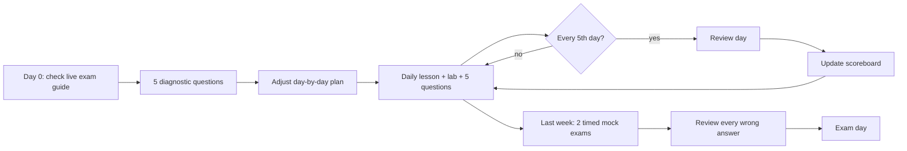

# AWS Certified AI Practitioner (AIF-C01) — Study Repo

This repo holds my study plan, lessons, labs, practice and tracking for the AWS AIF-C01 exam.
A coach (Claude) follows the rules in [`COACH_PROMPT.md`](COACH_PROMPT.md).

**Last verified:** 2026-11-24 against the official exam guide, version 1.2 (published 2026-10-29).
AWS publishes guide updates about one month before they take effect. Check again before the exam.

## Exam facts (verified)

| Item | Value | Source |
|---|---|---|
| Questions | 65 (50 scored, 15 unscored; unscored are not marked) | Exam guide |
| Time | 90 minutes (120 minutes with the ESL +30 accommodation) | AWS exam page, AWS policies |
| Passing score | 700 on a scale of 100–1,000 | Exam guide |
| Scoring model | Compensatory: no need to pass each domain alone | Exam guide |
| Guessing | No penalty. Unanswered = wrong. Answer every question. | Exam guide |
| Question types | Multiple choice and multiple response (official page). Some sites also list ordering, matching and case study. Practice all five to be safe. | Exam guide; third-party (unconfirmed) |
| Cost | 100 USD (tax and exchange rate can change the final price) | AWS exam page |
| Delivery | Pearson VUE test centre or online proctored | AWS exam page |

| Domain | Weight | Task statements |
|---|---|---|
| D1 Fundamentals of AI and ML | 20% | 1.1, 1.2, 1.3 |
| D2 Fundamentals of GenAI | 24% | 2.1, 2.2, 2.3 |
| D3 Applications of Foundation Models | 28% | 3.1, 3.2, 3.3, 3.4 |
| D4 Guidelines for Responsible AI | 14% | 4.1, 4.2 |
| D5 Security, Compliance, and Governance for AI Solutions | 14% | 5.1, 5.2 |

Target candidate (from the guide): up to 6 months of exposure to AI/ML on AWS. The candidate **uses** AI/ML solutions and does not necessarily build them.
Out of scope for the candidate: developing models, feature engineering, hyperparameter tuning, building pipelines, statistical analysis of models.

> The guide changed in 2026. It now covers **agentic AI, MCP, context engineering, prompt caching, model distillation, Amazon Nova, Bedrock AgentCore, Strands Agents and Kiro.**
> Older study material may miss these. See [`plan/exam-guide-map.md`](plan/exam-guide-map.md).

## Study flow



## Repo layout

```
aws-aif-study/
├── COACH_PROMPT.md      # Rules for the coach (source of truth)
├── CHANGELOG.md         # Every change, with source
├── scoreboard.md        # % correct by domain and task statement
├── exam-day.md          # Booking steps and exam-day tactics
├── plan/
│   ├── README.md        # Day-by-day plan (draft, 24 days)
│   └── exam-guide-map.md# All 14 task statements, mapped to days
├── days/                # One lesson file per day (dayNN-topic.md)
├── labs/                # Low-cost hands-on labs with cleanup steps
├── cheatsheets/         # One page per domain + service lists
├── mocks/               # Mock exams and wrong-answer reviews
└── templates/           # Lesson template
```

## How each lesson is taught

1. Plain definition
2. Why it matters and where the exam tests it (task statement number)
3. Diagram
4. Real example (DevOps / cloud case)
5. Comparison table with look-alike options
6. "Pick this when / not this when" rule
7. Exam traps and keywords
8. 3 practice questions (include multiple response), then explanations
9. Recap, sources and "Last verified" date

## Personal settings (fill in)

- Study time: `[X]` hours per day
- Duration: `[Y]` weeks (the draft plan uses 24 days)
- Target exam date: `[date]`
- Time zone: IST
- ESL +30 minutes: request it **before** you schedule the exam (see `exam-day.md`)
