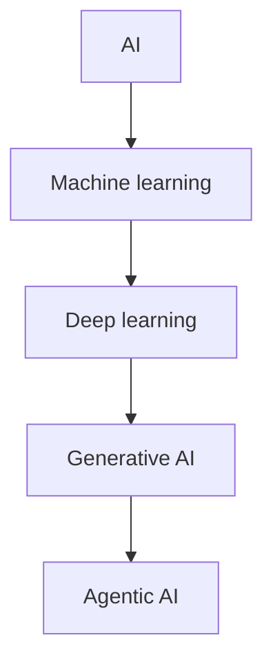

# Day 01 — Basic AI Concepts and Terms

- Domain: D1 Fundamentals of AI and ML
- Task statements: 1.1
- Time needed: 2 hours
- Hands-on task: none (read, then do the questions)
- Last verified: 2026-11-24 (against exam guide v1.2)

## 1. Definition

- **AI** is software that does tasks that need human-like judgment.
- **ML** is AI that learns patterns from data. You do not write the rules.
- **Deep learning** is ML that uses neural networks with many layers.
- **Generative AI (GenAI)** is deep learning that creates new content: text, images, audio, code.
- **Agentic AI** is GenAI that plans steps and uses tools to reach a goal.

## 2. Why it matters (exam focus)

Task 1.1 asks you to **explain** terms. Expect short scenario questions: "Which type of learning fits this data?" or "What does this term mean?"

## 3. Key terms

| Term | Plain meaning |
|---|---|
| Model | The learned result of training. It maps inputs to outputs. |
| Algorithm | The method used to train the model. |
| Training | The model learns from data. |
| Inference | The trained model makes a prediction on new data. |
| NLP | AI that works with human language. |
| Computer vision | AI that works with images and video. |
| Neural network | Layers of connected nodes that learn patterns. |
| LLM | A large language model. It is trained on very large text data. |
| Bias (fairness) | The model treats groups unfairly. |
| Overfitting | Good on training data, bad on new data. |
| Underfitting | Bad on both training data and new data. |

## 4. Learning types

| Type | Data | Goal | Example |
|---|---|---|---|
| Supervised | Labeled | Predict a label or number | Spam or not spam |
| Unsupervised | Unlabeled | Find structure | Group customers into segments |
| Reinforcement | None up front; an agent gets rewards | Learn the best actions | A robot learns to walk |

## 5. Data types

- **Labeled** data has the right answer attached. **Unlabeled** data does not.
- **Structured** data fits rows and columns (tables, CSV).
- **Unstructured** data does not (images, audio, free text, video).
- **Time-series** data is ordered by time (sensor readings).

## 6. Inference types

| Type | Use when | AWS example |
|---|---|---|
| Real-time | You need an answer in milliseconds | SageMaker AI real-time endpoint |
| Batch | You score a large dataset and no one waits | SageMaker AI batch transform |
| Asynchronous | Requests are large or slow, results can come later | SageMaker AI asynchronous inference |
| Serverless | Traffic is rare or bursty, and you want scale to zero | SageMaker AI serverless inference |

## 7. DevOps link

- Training is like a build. The model is the artifact. Inference is the running service.
- Model drift is like configuration drift: it changes slowly and you need monitoring.

## 8. Exam traps

- "Bias" has two meanings. In **fairness**, it means unfair treatment. In **fit**, it means the model is too simple (underfit).
- Supervised learning **needs labels**. If the question says "no labels", think unsupervised.
- Training builds the model. Inference uses it.

## 9. Practice questions

1. A company has 50,000 emails that staff marked "spam" or "not spam". It wants a model to label new emails. Which learning type fits?
   - A. Unsupervised learning
   - B. Supervised learning
   - C. Reinforcement learning
   - D. Transfer learning
2. A model scores 99% on training data and 70% on new data. What is the problem?
   - A. Underfitting
   - B. Data leakage into the inference endpoint
   - C. Overfitting
   - D. Low latency
3. Which TWO are examples of unstructured data? (Choose TWO.)
   - A. Rows in a relational table
   - B. Product photos
   - C. Call-centre audio recordings
   - D. A CSV file with fixed columns
   - E. A table of monthly sales totals

## 10. Answer key

> Cover this section until you have answered.

1. **B.** The data has labels, so this is supervised learning. A: unsupervised has no labels. C: reinforcement learning uses rewards from an environment. D: transfer learning reuses a trained model, it is not a learning type for this case.
2. **C.** High training score and low new-data score is overfitting. A: underfitting is poor on both. B: not a fit problem. D: latency is about speed.
3. **B and C.** Images and audio do not fit rows and columns. A, D, E: all are tables, which are structured.

## Recap

1. AI contains ML. ML contains deep learning. Deep learning contains GenAI.
2. Supervised uses labels. Unsupervised finds groups. Reinforcement uses rewards.
3. Training builds the model. Inference uses it.

## Sources

- Exam guide, domain 1: https://docs.aws.amazon.com/aws-certification/latest/ai-practitioner-01/ai-practitioner-01-domain1.html
- Inference-type examples (SageMaker AI) are from general knowledge. Confirm in the SageMaker AI developer guide.

Next: Day 02 — practical use cases and managed AI services.
