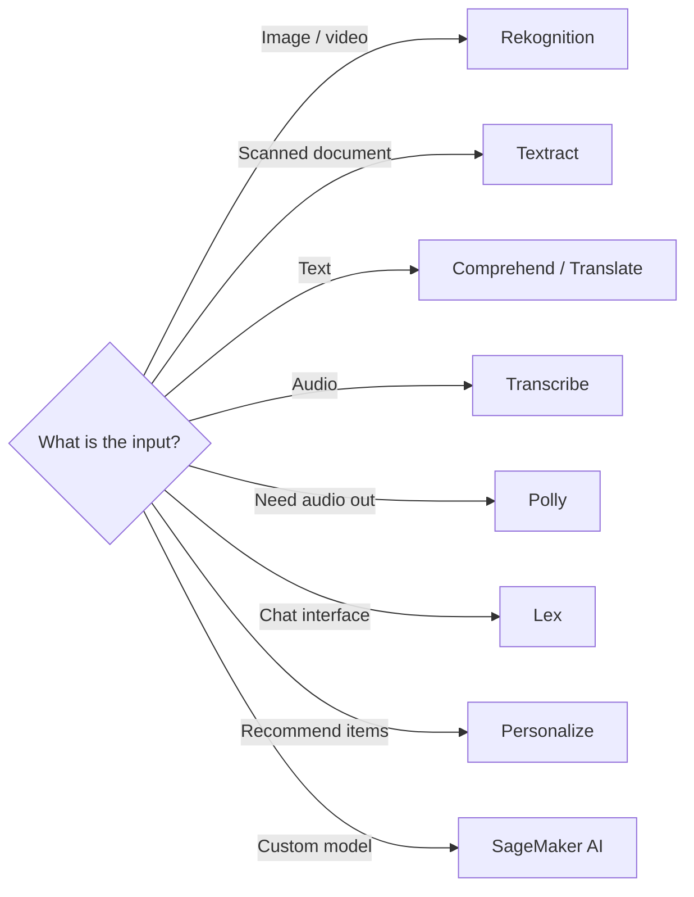

# Day 02 — Practical Use Cases and Managed AI Services

- Domain: D1 Fundamentals of AI and ML
- Task statements: 1.2
- Time needed: 2 hours (plus 45 minutes for Lab 5)
- Hands-on task: Lab 5 (Rekognition, Comprehend, Textract with boto3)
- Last verified: 2026-11-24 (against exam guide v1.2)

## 1. Definition

A **use case** is a business problem you want to solve. AI/ML fits when there are patterns in data that are too complex for fixed rules.

## 2. Why it matters (exam focus)

Task 1.2 asks you to **identify** when AI helps, when it does not, and which AWS service fits a task. This is a "scenario to service" task.

## 3. When AI/ML is a good fit

- The task needs patterns in a lot of data (fraud, recommendations).
- Rules would be too many or too hard to write.
- The task must scale (millions of images).
- The task needs personalization.

## 4. When AI/ML is NOT a good fit

- A simple fixed rule or formula works (for example, a tax formula).
- You need an exact, repeatable result every time, with no error.
- You do not have enough good data.
- The cost is higher than the value.

## 5. ML problem types

| Type | Output | Example |
|---|---|---|
| Regression | A number | Predict house price |
| Classification | A category | Fraud or not fraud |
| Clustering | Groups with no labels | Customer segments |

## 6. Managed AI services (pick by task)

| Service | What it does | Pick it when |
|---|---|---|
| Amazon Rekognition | Finds objects, faces, text and unsafe content in images and video | "Analyze images or video" |
| Amazon Textract | Extracts text, tables and forms from scanned documents | "Read invoices, forms, PDFs" |
| Amazon Comprehend | NLP: sentiment, entities, key phrases, language, PII | "Understand text" |
| Amazon Transcribe | Speech to text | "Transcribe calls" |
| Amazon Polly | Text to speech | "Make audio from text" |
| Amazon Translate | Translate text between languages | "Translate content" |
| Amazon Lex | Build chat and voice bots | "Build a chatbot" |
| Amazon Personalize | Product and content recommendations | "Recommend items" |
| Amazon SageMaker AI | Build, train and deploy your own models | "Custom model, full control" |

## 7. Traditional ML vs foundation models

| | Traditional ML | Foundation model (FM) |
|---|---|---|
| Training | Train one model per task on your data | Pre-trained on huge data, reused for many tasks |
| Data needed | Task-specific labeled data | Little or none (prompt, or small tuning set) |
| Output | Predict a label or number | Generate text, images, code |
| Cost to start | Higher effort | Lower effort |

## 8. Exam traps

- "Read text from a scanned form" is **Textract**, not Comprehend. Comprehend works on text that already exists.
- "Understand sentiment of reviews" is **Comprehend**.
- "Build your own model" or "custom algorithm" points to **SageMaker AI**.
- If the question asks for the **least effort** and a managed AI service fits, choose it over SageMaker AI.

## 9. Practice questions

1. A company wants to extract printed text and tables from scanned invoices with the least effort. Which service fits?
   - A. Amazon Comprehend
   - B. Amazon Rekognition
   - C. Amazon Textract
   - D. Amazon Polly
2. Which task is NOT a good fit for machine learning?
   - A. Recommend products to each shopper
   - B. Detect fraud in card payments
   - C. Calculate sales tax from a fixed legal formula
   - D. Group customers by buying behavior
3. Which TWO are classification tasks? (Choose TWO.)
   - A. Decide whether a payment is fraud or not
   - B. Predict next month's total sales amount
   - C. Label an email as spam or not spam
   - D. Estimate the price of a house
   - E. Group customers into segments with no labels

## 10. Answer key

> Cover this section until you have answered.

1. **C.** Textract reads text, tables and forms from scans. A: Comprehend analyzes text that is already digital. B: Rekognition analyzes images and video content (objects, faces). D: Polly turns text into speech.
2. **C.** A fixed formula needs an exact result, so use rules. A, B, D are pattern-based tasks where ML helps.
3. **A and C.** Both choose between categories. B and D predict a number (regression). E has no labels (clustering).

## Recap

1. ML fits pattern-heavy, large-scale tasks. It does not fit exact, rule-based tasks.
2. Regression predicts a number. Classification picks a category. Clustering finds groups.
3. Match the input type to the managed service: image, document, text, audio, chat.

## Sources

- Exam guide, domain 1: https://docs.aws.amazon.com/aws-certification/latest/ai-practitioner-01/ai-practitioner-01-domain1.html
- Service summaries are from general knowledge of each service. Confirm on each service's AWS page.

Next: Day 03 — the AI/ML development lifecycle.
