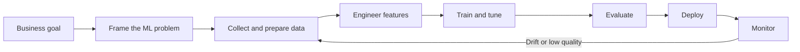

# Day 03 — ML Lifecycle, MLOps and Metrics

- Domain: D1 Fundamentals of AI and ML
- Task statements: 1.3
- Time needed: 2.5 hours (plus 1 hour for Lab 4)
- Hands-on task: Lab 4 (SageMaker JumpStart). Delete the endpoint when done.
- Last verified: 2026-11-24 (against exam guide v1.2)

## 1. Definition

The **ML lifecycle** is the set of stages from a business goal to a model in production, and then monitoring and improvement. **MLOps** is DevOps practice applied to ML.

## 2. Why it matters (exam focus)

Task 1.3 asks you to **describe** the pipeline stages, where models come from, MLOps ideas, and how to judge a model with technical and business metrics.

## 3. Lifecycle

## 4. Where do models come from?

| Source | Meaning | Example |
|---|---|---|
| Open-source pre-trained model | Free weights you host and control | Models in SageMaker JumpStart |
| Model through a managed API | You call a hosted FM. No hosting work | Amazon Bedrock |
| Custom-trained model | You train on your own data | SageMaker AI training |

Managed API means less work and faster start. Self-hosting means more control over data, cost and tuning.

## 5. MLOps ideas

- **Experimentation:** track runs, data and settings.
- **Repeatable processes:** automated pipelines, not manual steps.
- **Scalable systems:** work with more data and traffic.
- **Technical debt:** manage messy code, data and models.
- **Production readiness:** testing, security, rollback.
- **Monitoring and retraining:** detect drift, then retrain.

DevOps link: this is CI/CD plus observability for models and data.

## 6. Model metrics (classification)

Use TP, FP, TN, FN (true/false positive/negative).

| Metric | Formula | Use when |
|---|---|---|
| Accuracy | (TP + TN) / all | Classes are balanced |
| Precision | TP / (TP + FP) | A false alarm is costly |
| Recall | TP / (TP + FN) | A missed case is costly (fraud, disease) |
| F1 | Harmonic mean of precision and recall | You need a balance |

Extra (beyond the guide): AUC and RMSE. Know the names only.

## 7. Business metrics

Cost per user, development cost, customer feedback, return on investment (ROI), and productivity gain. A model with a good F1 can still fail if the cost is too high.

## 8. AWS services in the lifecycle (know the role)

- **SageMaker AI:** build, train and deploy models.
- **Bedrock:** use foundation models through an API.
- **Kiro** and **Quick** are named in this task of the guide. Read their official pages before you study them in detail (see Day 08).

## 9. Exam traps

- "Missing a positive case is very costly" means **recall**.
- "Do not raise a false alarm" means **precision**.
- A model that worked at launch and gets worse over time points to **drift**. Fix: monitor and retrain.

## 10. Practice questions

1. A bank builds a fraud model. Missing a real fraud case is very costly. Which metric should the team focus on?
   - A. Recall
   - B. Precision
   - C. Latency
   - D. Training time
2. A deployed model gets less accurate as customer behavior changes. What should the team do?
   - A. Delete the model and stop the project
   - B. Monitor the model and retrain it with fresh data
   - C. Lower the inference instance size
   - D. Increase the number of Availability Zones
3. Which TWO are benefits of MLOps? (Choose TWO.)
   - A. Repeatable and automated pipelines
   - B. Continuous monitoring and retraining
   - C. A guarantee of 100% accuracy
   - D. No need for training data
   - E. No ongoing cost

## 11. Answer key

> Cover this section until you have answered.

1. **A.** Recall measures how many real positives you catch. B: precision is about false alarms. C, D: not quality metrics for this need.
2. **B.** This is drift. Monitor it and retrain. A: too extreme. C, D: do not fix accuracy.
3. **A and B.** These are core MLOps goals. C, D, E: no process can promise these.

## Recap

1. Lifecycle: goal, data, features, train, evaluate, deploy, monitor, retrain.
2. Models come from open source, a managed API, or your own training.
3. Recall catches misses. Precision avoids false alarms. Monitor for drift.

## Sources

- Exam guide, domain 1: https://docs.aws.amazon.com/aws-certification/latest/ai-practitioner-01/ai-practitioner-01-domain1.html
- Metric formulas are standard ML definitions (general knowledge).

Next: Day 04 — GenAI concepts: tokens, embeddings, transformers, context engineering.
