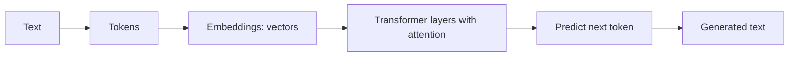
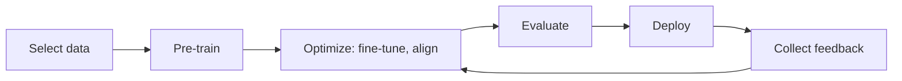

# Day 04 — GenAI Concepts: Tokens, Embeddings, Transformers, Context

- Domain: D2 Fundamentals of GenAI
- Task statements: 2.1 (part 1; agentic AI is on Day 06)
- Time needed: 2.5 hours
- Hands-on task: none
- Last verified: 2026-11-24 (against exam guide v1.2)

## 1. Definition

A **foundation model (FM)** is a large model pre-trained on broad data. You can use it for many tasks. An **LLM** is an FM for language.

## 2. Why it matters (exam focus)

Task 2.1 asks you to **explain** the basic ideas. You need clear words for each term, and you must connect them to cost and quality.

## 3. Key terms

| Term | Plain meaning |
|---|---|
| Token | A small piece of text (a word or part of a word). Models read and write tokens. |
| Context window | The maximum tokens the model can read and write in one request. |
| Chunking | Splitting a long document into smaller pieces. |
| Embedding | A list of numbers that captures the meaning of text or an image. |
| Vector | The list of numbers inside an embedding. Close vectors mean close meaning. |
| Transformer | The neural network design behind most LLMs. It uses attention to see relations between tokens. |
| Multimodal model | Works with more than one data type (text, image, audio, video). |
| Diffusion model | Makes images by learning to remove noise step by step. |
| Prompt | The input you give to the model. |
| Hallucination | A confident answer that is false or not supported. |
| Nondeterminism | The same prompt can give different answers. |

## 4. Foundation model lifecycle

## 5. Token-based pricing

On-demand FM calls are billed **per token**: input tokens plus output tokens. Longer prompts and longer answers cost more. This is why prompt length, output limits and caching matter (Day 09).

## 6. Context engineering

**Context engineering** is choosing what goes into the context window. Good context has the right instructions, the right retrieved facts, the right tool results and the right history. Too much context costs more and can confuse the model.

| Context part | Example |
|---|---|
| System instructions | "You are a support assistant." |
| Retrieved facts | Passages from a knowledge base |
| Tool results | Output of an API call |
| History and memory | Earlier turns, saved user notes |

## 7. Use cases (know a few)

Chat assistants, summarization, code generation, translation, image generation, search over company documents, data extraction.

## 8. DevOps link

A context window is like a memory limit. You cannot load everything. You pick what to load, and larger loads cost more.

## 9. Exam traps

- Embeddings turn data into vectors. They do **not** generate text.
- Tokens are not the same as words.
- Temperature changes variation, but it does not remove hallucination.

## 10. Practice questions

1. Which term describes numbers that capture the meaning of text so that similar texts are close together?
   - A. Token
   - B. Embedding
   - C. Epoch
   - D. Label
2. Which type of model creates images by learning to remove noise step by step?
   - A. Diffusion model
   - B. Decision tree
   - C. Linear regression
   - D. Clustering model
3. Which TWO factors increase the cost of an on-demand FM request? (Choose TWO.)
   - A. A longer prompt (more input tokens)
   - B. A longer generated answer (more output tokens)
   - C. More IAM roles in the account
   - D. More Availability Zones in the Region
   - E. A shorter system name

## 11. Answer key

> Cover this section until you have answered.

1. **B.** Embeddings place similar meaning close together. A: tokens are text pieces. C: an epoch is a training pass. D: a label is a target answer.
2. **A.** Diffusion models denoise step by step. B, C, D are not image generators.
3. **A and B.** Billing is per input and output token. C, D, E do not change token cost.

## Recap

1. Tokens are the units the model reads and writes. Embeddings are meaning as vectors.
2. Transformers use attention. Diffusion models make images.
3. Cost follows tokens. Context engineering decides what goes into the window.

## Sources

- Exam guide, domain 2: https://docs.aws.amazon.com/aws-certification/latest/ai-practitioner-01/ai-practitioner-01-domain2.html
- Cost optimization (token billing, caching): https://aws.amazon.com/bedrock/cost-optimization/

Next: Day 05 — review of Domain 1.
