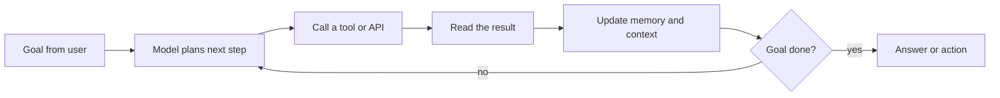

# Day 06 — Agentic AI, MCP and Multi-Agent Systems

- Domain: D2 Fundamentals of GenAI
- Task statements: 2.1 (part 2)
- Time needed: 2.5 hours
- Hands-on task: optional Lab 6 (Strands Agents). Steps are not written yet.
- Last verified: 2026-11-24 (against exam guide v1.2)

## 1. Definition

An **AI agent** is a program that uses an FM to plan steps, call tools and reach a goal. **Agentic AI** means systems built from such agents.

## 2. Why it matters (exam focus)

Agentic AI is new in guide v1.2. Task 2.1 asks you to **explain** the basics: multi-agent patterns, MCP, memory, tool use and workflow orchestration.

## 3. The agent loop

An agent has four parts:

| Part | Role |
|---|---|
| Model (FM) | Reasons and decides |
| Tools | Functions the agent can call (API, database, code, search) |
| Memory | Short-term (this session) and long-term (across sessions) |
| Instructions | Goal, rules and limits |

## 4. Workflow vs agent

| | Workflow | Agent |
|---|---|---|
| Steps | Fixed by you | Chosen by the model |
| Cost and delay | Lower, predictable | Higher, varies |
| Risk | Lower | Higher (needs limits and approvals) |
| Use when | Steps are known | Steps are unknown or change |

Rule: use a workflow when you can. Use an agent when you must.

## 5. Multi-agent patterns

- **Supervisor (orchestrator):** one agent splits the task and sends parts to specialist agents.
- **Collaboration:** several agents share work and results.
- **Agent as a tool:** one agent calls another agent like a function.

## 6. Model Context Protocol (MCP)

MCP is an **open standard** for connecting AI applications to external tools, data and workflows. Think "USB-C for AI apps". It uses a client-server design. The AI app is the client. Each MCP server exposes tools. MCP uses JSON-RPC messages between hosts, clients and servers.

Why it matters: one standard connector replaces many custom integrations.

## 7. AWS names for agents (details on Day 08)

- **Strands Agents:** open-source SDK from AWS. It is model-driven: you give a model, a prompt and tools, and the model plans and calls tools.
- **Amazon Bedrock AgentCore:** a platform to build, deploy and operate agents securely at scale, with any framework and any model. Parts include Runtime, Memory, Gateway, Identity, Browser and Code Interpreter. Gateway can turn APIs and Lambda functions into MCP-compatible tools.

## 8. DevOps link

Agents need what any production service needs: identity, least privilege, limits (step and token caps), logs and rollback. Treat tool permissions like IAM policies.

## 9. Exam traps

- MCP is a **protocol**, not a model and not an AWS service.
- Strands is an **SDK** (build). AgentCore is a **platform** (run and operate).
- More autonomy means more risk. The safe answer adds limits and human approval for risky actions.

## 10. Practice questions

1. Which open standard lets AI applications connect to external tools and data in a common way?
   - A. Model Context Protocol (MCP)
   - B. Simple Mail Transfer Protocol
   - C. Border Gateway Protocol
   - D. Transport Layer Security
2. A team built agents with any framework. It wants a serverless, secure place to host them, with each user session isolated. Which AWS offering fits?
   - A. Amazon Polly
   - B. Amazon Bedrock AgentCore Runtime
   - C. Amazon Rekognition
   - D. AWS Artifact
3. Which TWO features separate an agentic application from a single prompt-and-response call? (Choose TWO.)
   - A. It can plan steps and call tools in a loop
   - B. It can keep memory across steps
   - C. It uses exactly one request and one response
   - D. It does not use a model
   - E. It can never reach external systems

## 11. Answer key

> Cover this section until you have answered.

1. **A.** MCP is the open standard for AI-to-tool connections. B, C, D are unrelated network protocols.
2. **B.** AgentCore Runtime is a secure serverless host with session isolation (each session runs in its own microVM). A, C are AI services for speech and images. D gives compliance reports.
3. **A and B.** Agents loop with tools and use memory. C describes a plain model call. D is false. E is the opposite of agent behavior.

## Recap

1. An agent = model + tools + memory + instructions, in a loop.
2. MCP is an open standard "connector" between AI apps and tools.
3. Strands builds agents. AgentCore hosts and runs them securely.

## Sources

- MCP intro: https://modelcontextprotocol.io/docs/2026-07-28/getting-started/intro
- AWS on MCP and tools: https://docs.aws.amazon.com/prescriptive-guidance/latest/mcp-strategies/what-is-mcp.html
- AgentCore overview: https://docs.aws.amazon.com/bedrock-agentcore/latest/devguide/what-is-bedrock-agentcore.html
- AgentCore Runtime (session isolation): https://docs.aws.amazon.com/bedrock-agentcore/latest/devguide/agents-tools-runtime.html
- Strands Agents: https://aws.amazon.com/blogs/opensource/introducing-strands-agents-an-open-source-ai-agents-sdk/

Next: Day 07 — capabilities and limits of GenAI.
