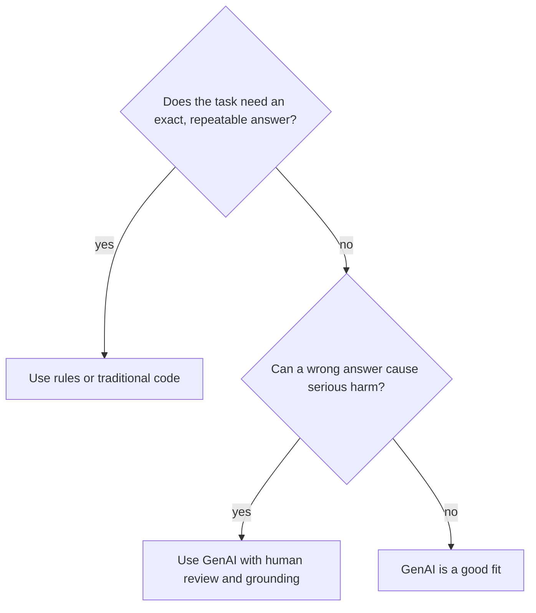

# Day 07 — Capabilities and Limits of GenAI for Business

- Domain: D2 Fundamentals of GenAI
- Task statements: 2.2
- Time needed: 2 hours
- Hands-on task: none
- Last verified: 2026-11-24 (against exam guide v1.2)

## 1. Definition

This task is about judging **when GenAI is a good tool for a business problem**, what can go wrong, and how to measure value.

## 2. Why it matters (exam focus)

Task 2.2 asks you to **understand** advantages and disadvantages, **choose** models with the right factors, and **link** GenAI to business metrics.

## 3. Advantages

| Advantage | Meaning |
|---|---|
| Adaptability | One model handles many tasks with a new prompt |
| Responsiveness | Fast answers at any hour |
| Simplicity | Natural language is the interface |
| Creativity | Drafts, ideas, variations |
| Productivity | Summaries, code help, content at scale |

## 4. Disadvantages and limits

| Limit | Meaning | Common fix |
|---|---|---|
| Hallucination | False answers that sound right | RAG, citations, grounding checks |
| Nondeterminism | Output changes between runs | Lower temperature, validation, rules for exact tasks |
| Inaccuracy | Wrong or outdated facts | RAG with current data |
| Interpretability | Hard to explain why | Logging, evaluation, human review |
| Bias and toxicity | Unfair or harmful output | Guardrails, data review |
| Privacy risk | Sensitive data in prompts | Redaction, access control |
| Cost and latency | Large models are slower and cost more | Smaller model, caching |

## 5. Factors to choose a model

- Model type and modality (text, image, multimodal)
- Performance needs (quality, speed)
- Capabilities (languages, reasoning, tool use)
- Constraints (cost, size, context window, region)
- Compliance and data rules

## 6. Business metrics for GenAI

| Metric | Example |
|---|---|
| ROI | Savings minus cost |
| Efficiency | Average handling time down |
| Conversion rate | More visitors become buyers |
| ARPU | Revenue per user |
| Accuracy | Correct answers rate |
| Customer lifetime value (CLV) | Value over the customer relationship |
| Customer satisfaction (CSAT) | Survey score |

## 7. Exam traps

- "Exact calculation every time" is a weak fit for GenAI.
- Hallucination is a **model** problem. The fix is **grounding and checks**, not a bigger prompt alone.
- Business questions want **business metrics** (ROI, CSAT, handling time), not technical ones (BLEU, GPU use).

## 8. Practice questions

1. A chatbot gives a confident answer that is not in any company document. What is this called?
   - A. Overfitting
   - B. Hallucination
   - C. Data drift
   - D. Tokenization
2. A bank needs the same output every time for a regulatory calculation. Which GenAI limit makes GenAI a poor fit?
   - A. Multimodality
   - B. Nondeterminism
   - C. Adaptability
   - D. Responsiveness
3. A company adds a GenAI assistant to customer support. Which TWO are business metrics to track? (Choose TWO.)
   - A. Average handling time per ticket
   - B. Customer satisfaction score
   - C. GPU temperature
   - D. Number of model parameters
   - E. BLEU score

## 9. Answer key

> Cover this section until you have answered.

1. **B.** A confident but unsupported answer is a hallucination. A is a training fit problem. C is a change in data over time. D splits text into tokens.
2. **B.** Outputs can vary between runs, so exact regulated results need rules. A, C, D are strengths or unrelated.
3. **A and B.** These show business value. C is infrastructure. D is a model property. E is a technical text-quality metric.

## Recap

1. GenAI is flexible and fast, but it can hallucinate and vary.
2. Use rules for exact tasks. Use grounding and review for risky tasks.
3. Judge value with business metrics.

## Sources

- Exam guide, domain 2: https://docs.aws.amazon.com/aws-certification/latest/ai-practitioner-01/ai-practitioner-01-domain2.html

Next: Day 08 — AWS services for GenAI.
