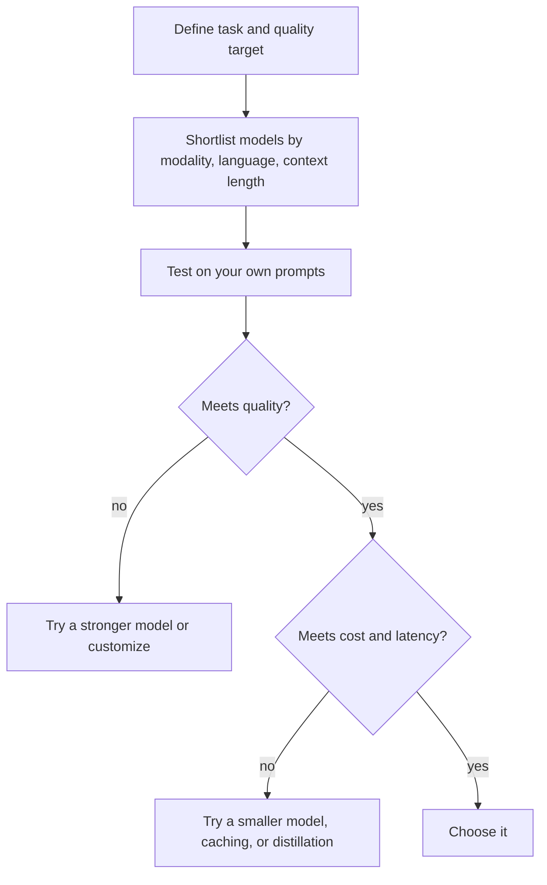

# Day 09 — Design Considerations: FM Selection, Inference Parameters, Prompt Caching

- Domain: D3 Applications of Foundation Models
- Task statements: 3.1 (part 1)
- Time needed: 2.5 hours
- Hands-on task: in the Bedrock playground, change temperature and max tokens and compare answers (use Lab 1 setup)
- Last verified: 2026-11-24 (against exam guide v1.2)

## 1. Definition

Before you build an app on an FM, you choose a model and set how it runs. These choices change **quality, speed and cost**.

## 2. Why it matters (exam focus)

Task 3.1 is the biggest task in the largest domain (D3 is 28%). Today covers model choice, inference parameters and prompt caching. Day 11 covers RAG and customization.

## 3. FM selection criteria

| Criterion | Question to ask |
|---|---|
| Cost | Price per input and output token? |
| Modality | Text only, or image, audio, video too? |
| Latency | How fast must the first and last token arrive? |
| Languages | Does it support the languages you need? |
| Size and complexity | Bigger models are often stronger but slower and costlier |
| Customization | Can you fine-tune or distill it? |
| Input and output length | Is the context window large enough? |
| Compliance and Region | Is it available where your data must stay? |

Tip: use a small, cheap model for easy tasks and a strong model for hard tasks.

## 4. Inference parameters

| Parameter | Effect |
|---|---|
| Temperature | Low = focused and repeatable. High = more varied and creative |
| Maximum length (max tokens) | Caps the answer length. Controls cost and runaway output |
| Stop sequences | Text that tells the model to stop |
| Top-p, top-k (extra) | Limit which tokens the model may pick |

Temperature does not make the model more correct. It changes variation.

## 5. Prompt caching

**Prompt caching** lets Amazon Bedrock reuse a repeated prompt prefix, so the model does not recompute it. It lowers **latency** and **input token cost**.

- Two types: **implicit** (automatic) and **explicit** (you set cache checkpoints). Support depends on the model.
- Works with on-demand inference. It is **not** supported with the batch inference API.
- Some models need a minimum prefix length (for example 1,024 tokens).
- Best fit: a long, stable prefix (system prompt, documents, examples) reused across many requests.

## 6. Other cost and speed tools

- **Intelligent Prompt Routing:** sends each request to a cheaper or stronger model by need.
- **Batch inference:** run large offline jobs asynchronously.
- **Provisioned Throughput:** dedicated capacity for steady load.

## 7. DevOps link

Prompt caching is like a CDN or build cache for the start of your prompt. Temperature is like a retry-jitter knob: it changes variation, not correctness.

## 8. Exam traps

- "Same long prompt sent again and again, cut cost and latency" is **prompt caching**.
- "More deterministic answers" means **lower temperature**.
- "Limit how long answers get" means **max tokens**.
- Caching helps **repeated prefixes**. It does not help when every prompt is different.

## 9. Practice questions

1. A developer wants more consistent, less random answers from a model. What should the developer do?
   - A. Raise the temperature
   - B. Lower the temperature
   - C. Remove the system prompt
   - D. Add more Availability Zones
2. An app sends the same 8,000-token policy document at the start of every request. How can the team cut input cost and latency?
   - A. Use prompt caching
   - B. Turn on AWS Config
   - C. Use Amazon Polly
   - D. Increase the temperature
3. Which TWO are valid criteria for choosing a foundation model? (Choose TWO.)
   - A. Supported input and output modalities
   - B. Context window size
   - C. The color theme of the console
   - D. The number of IAM users
   - E. The number of S3 buckets

## 10. Answer key

> Cover this section until you have answered.

1. **B.** Lower temperature gives more focused, repeatable output. A does the opposite. C, D do not control randomness.
2. **A.** Prompt caching reuses a stable prefix, so it lowers cost and latency. B checks configuration. C is text to speech. D increases variation.
3. **A and B.** Modalities and context length decide whether a model can do the task. C, D, E are unrelated to model fit.

## Recap

1. Choose models by cost, modality, latency, language, size, customization, context length, Region.
2. Temperature controls variation. Max tokens caps length.
3. Prompt caching reuses a repeated prefix. Not for batch inference.

## Sources

- Exam guide, domain 3: https://docs.aws.amazon.com/aws-certification/latest/ai-practitioner-01/ai-practitioner-01-domain3.html
- Prompt caching: https://docs.aws.amazon.com/bedrock/latest/userguide/prompt-caching.html
- Cost optimization (routing, batch, provisioned): https://aws.amazon.com/bedrock/cost-optimization/
- Temperature and max tokens definitions are standard (general knowledge).

Next: Day 10 — review of Domain 2.
