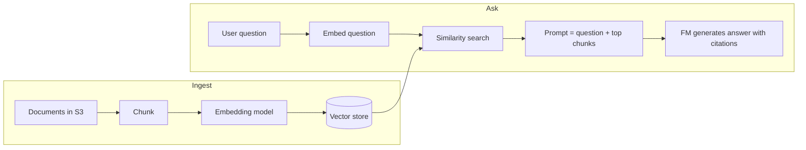

# Day 11 — RAG, Knowledge Bases, Vector Stores and Customization Cost

- Domain: D3 Applications of Foundation Models
- Task statements: 3.1 (part 2)
- Time needed: 3 hours (plus 1.5 hours for Lab 2)
- Hands-on task: Lab 2 (Knowledge Base with a small S3 document set). Delete the vector store when done.
- Last verified: 2026-11-24 (against exam guide v1.2)

## 1. Definition

**Retrieval-Augmented Generation (RAG)** adds facts from your own data to the prompt at request time. The model answers from those facts. You do not retrain the model.

## 2. Why it matters (exam focus)

Task 3.1 asks you to **describe** RAG, **vector stores**, the **cost of customization options**, and **agents** in business use. "Fresh private data without retraining" is a classic RAG question.

## 3. RAG flow



## 4. Amazon Bedrock Knowledge Bases

A managed RAG service. You point it to your data. It fetches documents, **chunks** them, creates **embeddings**, and stores them in a vector database you choose. It keeps the store in sync. The `RetrieveAndGenerate` API queries the knowledge base and generates a response with source attribution.

## 5. Vector stores (named in the guide)

| Store | Note |
|---|---|
| Amazon OpenSearch Service (and Serverless) | Common choice for vector search |
| Amazon Aurora (PostgreSQL) | Use your relational database for vectors |
| Amazon RDS for PostgreSQL | Same idea with RDS |
| Amazon Neptune | Graph database. Supports GraphRAG |
| Also supported by Knowledge Bases: Amazon S3 Vectors | Check current docs for the full list |

## 6. Ways to customize an FM (low to high cost and effort)

```
Prompt engineering  →  In-context learning (examples in prompt)  →  RAG
   →  Fine-tuning  →  Continued pre-training  →  Pre-training from scratch
cheapest, fastest                                       most expensive, slowest
```

| Method | Changes the model? | Best for |
|---|---|---|
| Prompt engineering | No | Clear tasks, format control |
| In-context learning (few-shot) | No | Show examples in the prompt |
| RAG | No | Current, private, changing facts |
| Fine-tuning | Yes | Style, format, task behavior (labeled examples) |
| Continued pre-training | Yes | Domain language (unlabeled domain text) |
| Distillation | Creates a smaller model | Cut cost and latency; a large "teacher" trains a small "student" |
| Pre-training from scratch | Yes | Rare. Very high cost |

Bedrock custom model options in the docs: **fine-tuning, distillation and continued pre-training**.

## 7. AI agents in business

Agents act on user requests: look up an order, open a ticket, call an API, then report back. Add limits, least-privilege tool access and human approval for risky actions. (Day 06.)

## 8. DevOps link

RAG is like fetching config at runtime instead of rebuilding the image. Fine-tuning is like rebuilding the image. Choose runtime fetch when data changes often.

## 9. Exam traps

- "Latest data, private documents, no retraining" is **RAG**.
- "Change tone, style or output format" points to **fine-tuning** or prompt examples.
- RAG improves **grounding**, but it does not make hallucination zero. Retrieval quality matters.
- An **embeddings model** is not the same as the **generation model**.

## 10. Practice questions

1. A company wants answers from internal documents that change every day, without retraining a model. Which approach fits?
   - A. Pre-train a new FM from scratch
   - B. Retrieval-Augmented Generation (RAG)
   - C. Increase the temperature
   - D. Fine-tune once a year
2. In a RAG pipeline, what does the embeddings model do?
   - A. It converts chunks and questions into vectors for similarity search
   - B. It writes the final answer
   - C. It encrypts the documents
   - D. It stores the documents
3. Which TWO can be used as vector stores with Amazon Bedrock Knowledge Bases? (Choose TWO.)
   - A. Amazon OpenSearch Service or Serverless
   - B. Amazon Aurora PostgreSQL
   - C. Amazon Polly
   - D. Amazon Lex
   - E. AWS Config

## 11. Answer key

> Cover this section until you have answered.

1. **B.** RAG pulls current facts at request time with no retraining. A is very costly. C changes variation only. D cannot keep up with daily changes.
2. **A.** Embeddings make vectors so similar text can be found. B is the generation model's job. C, D are other services' jobs.
3. **A and B.** OpenSearch and Aurora PostgreSQL can hold vectors. C and D are AI services. E is a configuration tool.

## Recap

1. RAG = retrieve facts, add to prompt, generate. No retraining.
2. Knowledge Bases manage chunking, embedding and sync. Vector stores include OpenSearch, Aurora, RDS PostgreSQL and Neptune.
3. Cost order: prompts, examples, RAG, fine-tuning, continued pre-training, pre-training.

## Sources

- Knowledge Bases overview: https://docs.aws.amazon.com/prescriptive-guidance/latest/retrieval-augmented-generation-options/rag-fully-managed-bedrock.html
- S3 Vectors with Knowledge Bases: https://docs.aws.amazon.com/AmazonS3/latest/userguide/s3-vectors-bedrock-kb.html
- Bedrock custom model methods: https://docs.aws.amazon.com/bedrock/
- Exam guide, domain 3: https://docs.aws.amazon.com/aws-certification/latest/ai-practitioner-01/ai-practitioner-01-domain3.html

Next: Day 12 — prompt engineering.
