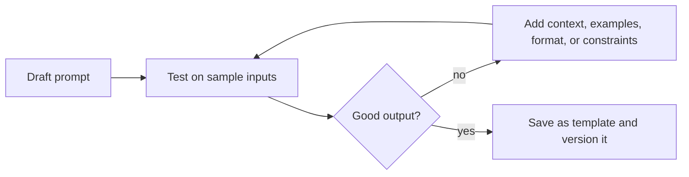

# Day 12 — Prompt Engineering

- Domain: D3 Applications of Foundation Models
- Task statements: 3.2
- Time needed: 2 hours
- Hands-on task: in the Bedrock playground, try zero-shot, few-shot and chain-of-thought on one task and compare
- Last verified: 2026-11-24 (against exam guide v1.2)

## 1. Definition

**Prompt engineering** is writing inputs that guide the model to the output you want. It is the cheapest way to change model behavior.

## 2. Why it matters (exam focus)

Task 3.2 asks you to **choose** techniques, know best practices and know the **risks**.

## 3. Parts of a good prompt

| Part | Purpose |
|---|---|
| Instruction | The task |
| Context | Background facts or role |
| Input data | The text to work on |
| Output indicator | The format you want (list, JSON, length) |
| Negative prompt | What to avoid |

## 4. Techniques

| Technique | What you do | Use when |
|---|---|---|
| Zero-shot | Give the task with no examples | The task is simple and common |
| Single-shot | Give one example | You need a format hint |
| Few-shot | Give several examples | You need a pattern or style |
| Chain-of-thought | Ask the model to reason step by step | Math, logic, multi-step tasks |
| Prompt template | Fixed text with placeholders | Many similar requests |
| Role prompt | "Act as a support agent" | You need a tone or viewpoint |

## 5. Best practices

- Be clear and specific.
- Give examples of the output you want.
- State the format and length.
- Break big tasks into steps.
- Test and refine. Save versions.
- Tell the model what to do, not only what to avoid.

## 6. Bedrock Prompt Management

Create, version, test and reuse prompts in one place. You can turn on prompt caching for a prompt there. This supports repeatable prompts across a team.

## 7. Risks

| Risk | Meaning |
|---|---|
| Exposure | The prompt or output reveals sensitive data |
| Poisoning | Bad data is put into training or retrieval data to bend outputs |
| Hijacking (prompt injection) | Hidden or user instructions take over the model's task |
| Jailbreaking | A user tries to bypass safety rules |

Controls: input and output filters (Guardrails), least-privilege tools, separating instructions from data, and monitoring.

## 8. DevOps link

Prompts are code. Keep them in version control, review changes and test them before release. Never edit production prompts by hand.

## 9. Exam traps

- "Show the model a few examples" is **few-shot**.
- "Reason step by step" is **chain-of-thought**.
- Putting untrusted text into a prompt without controls can cause **injection**.
- A better prompt does not add new knowledge. Use RAG for new facts.

## 10. Practice questions

1. A developer includes three example inputs with their ideal outputs in the prompt. Which technique is this?
   - A. Zero-shot prompting
   - B. Few-shot prompting
   - C. Fine-tuning
   - D. Distillation
2. Which technique asks the model to explain its reasoning step by step before it gives the final answer?
   - A. Chain-of-thought prompting
   - B. Negative prompting
   - C. Temperature scaling
   - D. Batch inference
3. Which TWO are risks that apply to prompts and generative AI inputs? (Choose TWO.)
   - A. Poisoning
   - B. Jailbreaking
   - C. Right-sizing
   - D. Overprovisioning
   - E. Rate limiting by design

## 11. Answer key

> Cover this section until you have answered.

1. **B.** Several examples in the prompt is few-shot. A has no examples. C and D change or create a model, not the prompt.
2. **A.** Chain-of-thought asks for step-by-step reasoning. B says what to avoid. C and D are not prompt techniques.
3. **A and B.** Poisoning and jailbreaking are named prompt-related risks. C, D are capacity terms. E is a control, not a risk.

## Recap

1. Zero-shot has no examples. Few-shot has several. Chain-of-thought asks for steps.
2. Good prompts are clear, specific and tested. Version them like code.
3. Risks: exposure, poisoning, hijacking, jailbreaking.

## Sources

- Exam guide, domain 3: https://docs.aws.amazon.com/aws-certification/latest/ai-practitioner-01/ai-practitioner-01-domain3.html
- Prompt caching in Prompt Management: https://docs.aws.amazon.com/bedrock/latest/userguide/prompt-caching.html
- Technique definitions are standard (general knowledge).

Next: Day 13 — training and fine-tuning FMs.
