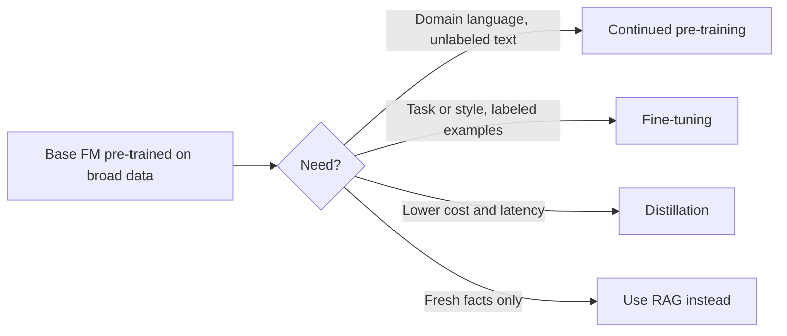

# Day 13 — Training and Fine-Tuning Foundation Models

- Domain: D3 Applications of Foundation Models
- Task statements: 3.3
- Time needed: 2 hours
- Hands-on task: none (read the Bedrock "Custom models" page and note the three methods)
- Last verified: 2026-11-24 (against exam guide v1.2)

## 1. Definition

- **Pre-training** teaches a model general knowledge from very large, mostly unlabeled data.
- **Fine-tuning** adapts a pre-trained model to a task or style with a smaller, labeled dataset.

## 2. Why it matters (exam focus)

Task 3.3 asks you to **describe** the methods and how to **prepare data**. Expect "which method fits this need" questions.

## 3. Methods

| Method | Data | Goal | Cost |
|---|---|---|---|
| Pre-training | Huge, unlabeled | Build a base model | Very high |
| Continued (continuous) pre-training | Large unlabeled domain text | Teach domain language (law, medicine) | High |
| Fine-tuning | Labeled prompt and response pairs | Improve a task, tone or format | Medium |
| Instruction tuning | Prompts with instructions and answers | Follow instructions better | Medium |
| Domain adaptation | Domain data | Adapt to one field | Medium |
| Transfer learning | A trained model reused on a new task | Save time and data | Lower |
| Distillation | Outputs from a large "teacher" model | Make a smaller, cheaper "student" model | Medium |

In Bedrock, the custom model methods listed in the docs are fine-tuning, distillation and continued pre-training.

## 4. Preparing data for fine-tuning

| Step | Meaning |
|---|---|
| Curation | Pick relevant, clean, correct examples |
| Governance | Check rights, privacy and licensing |
| Size | Enough examples for the task. Quality beats quantity |
| Labeling | Correct, consistent labels |
| Representativeness | Cover the real range of users and cases, to reduce bias |

## 5. RLHF

**Reinforcement learning from human feedback (RLHF):** humans rank or rate model outputs. A reward signal then pushes the model toward answers people prefer. It helps align the model with human values and style.

## 6. DevOps link

Fine-tuning is like building a custom image on a base image. Continued pre-training is like rebuilding the base. RAG is like mounting config at runtime. Pick the lightest option that works.

## 7. Exam traps

- **Unlabeled** domain text points to **continued pre-training**.
- **Labeled** prompt and response pairs point to **fine-tuning**.
- Fine-tuning does **not** add live facts. Use RAG for changing facts.
- Poor or biased training data gives a poor or biased model.

## 8. Practice questions

1. A law firm has a large volume of unlabeled legal text. It wants the FM to understand legal language better. Which method fits?
   - A. Continued pre-training
   - B. Few-shot prompting only
   - C. Lowering the temperature
   - D. Batch inference
2. What kind of data is used for fine-tuning an FM for a task?
   - A. Labeled examples such as prompt and response pairs
   - B. Only random text with no structure
   - C. Only images with no labels
   - D. Network logs
3. Which TWO describe RLHF? (Choose TWO.)
   - A. Humans rank or rate model outputs
   - B. A reward signal guides the model toward preferred responses
   - C. It uses no human input
   - D. It stores vectors in a database
   - E. It replaces tokenization

## 9. Answer key

> Cover this section until you have answered.

1. **A.** Large unlabeled domain text suits continued pre-training. B, C, D do not teach the model domain language.
2. **A.** Fine-tuning uses labeled pairs. B, C, D are not suitable training sets for a task.
3. **A and B.** RLHF uses human ratings to build a reward signal. C is false. D, E are unrelated.

## Recap

1. Pre-training builds the base. Continued pre-training adds domain language (unlabeled).
2. Fine-tuning uses labeled pairs. Distillation makes a smaller student model.
3. Good data is curated, governed, labeled and representative. RLHF uses human feedback.

## Sources

- Exam guide, domain 3: https://docs.aws.amazon.com/aws-certification/latest/ai-practitioner-01/ai-practitioner-01-domain3.html
- Bedrock custom models (fine-tuning, distillation, continued pre-training): https://docs.aws.amazon.com/bedrock/
- Distillation concept: https://aws.amazon.com/blogs/aws/build-faster-more-cost-efficient-highly-accurate-models-with-amazon-bedrock-model-distillation-preview/ (preview-era article; check current docs for details)
- Method definitions are standard (general knowledge).

Next: Day 14 — evaluating FM performance.
