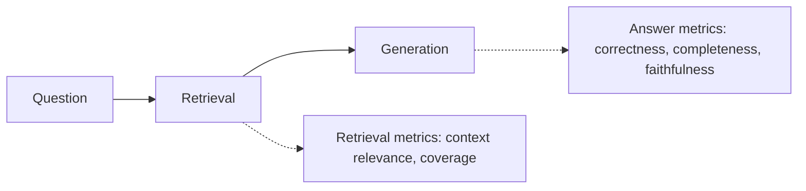

# Day 14 — Evaluating Foundation Model Performance

- Domain: D3 Applications of Foundation Models
- Task statements: 3.4
- Time needed: 2.5 hours
- Hands-on task: optional. Run a small model evaluation job in the Bedrock console. Check pricing first.
- Last verified: 2026-11-24 (against exam guide v1.2)

## 1. Definition

**Evaluation** checks if a model or an AI application is good enough for your use case. It uses human review, benchmarks, metrics and automated judging.

## 2. Why it matters (exam focus)

Task 3.4 asks you to **describe** methods and metrics, and to link results to **business goals**. New in v1.2: LLM-as-a-judge, and evaluating RAG, agents and workflows.

## 3. Evaluation methods

| Method | What it is | Good for |
|---|---|---|
| Human evaluation | People rate outputs | Quality, tone, safety. Slow and costly |
| Benchmark datasets | Standard test sets with known answers | Compare models fairly |
| Programmatic (automatic) metrics | Formulas such as ROUGE, BLEU, BERTScore, F1 | Fast checks at scale |
| LLM-as-a-judge | A second model scores the first model's outputs | Fast, human-like scoring of correctness, completeness, helpfulness |

Amazon Bedrock Evaluations supports human-based, programmatic and LLM-as-a-judge evaluation for models and for RAG systems.

## 4. Text metrics

| Metric | Task | Idea |
|---|---|---|
| ROUGE | Summarization | Overlap of words and phrases with a reference summary |
| BLEU | Machine translation | Overlap with a reference translation |
| BERTScore | Many text tasks | Meaning similarity using embeddings |
| F1 / exact match | Question answering | Match with the reference answer |

## 5. LLM-as-a-judge metrics (Bedrock)

- Quality: correctness, completeness, faithfulness (hallucination detection)
- User experience: helpfulness, coherence, relevance
- Responsible AI: harmfulness, answer refusal, stereotyping

## 6. Evaluating RAG

Evaluate **retrieval** and **generation** separately. A good answer needs good retrieved context first.

## 7. Evaluating agents and workflows (examples)

Check if the task is completed, if the right tool is chosen, and if the steps are safe and efficient. Also track cost and delay per task.

## 8. Business alignment

Link scores to goals: productivity gain, user engagement, task completion rate, user satisfaction and cost per interaction. A model can win a benchmark and still be wrong for your business.

## 9. DevOps link

Evaluation is your test suite for AI. Run it in CI. Re-run it when you change the model, the prompt or the retrieval setup.

## 10. Exam traps

- **ROUGE = summaries. BLEU = translation. BERTScore = meaning similarity.**
- "Hallucination check in RAG" is **faithfulness**.
- LLM-as-a-judge uses a model to score a model. It is fast. It is not a replacement for all human review.

## 11. Practice questions

1. A team compares AI-written summaries with reference summaries by word overlap. Which metric fits?
   - A. ROUGE
   - B. BLEU
   - C. RMSE
   - D. Latency
2. Which metric is mainly used to evaluate machine translation?
   - A. BLEU
   - B. ROUGE
   - C. Accuracy of a regression
   - D. Throughput
3. Which TWO are metrics that Amazon Bedrock offers when evaluating RAG? (Choose TWO.)
   - A. Context relevance
   - B. Faithfulness (hallucination detection)
   - C. CPU utilization
   - D. Disk IOPS
   - E. Subnet count

## 12. Answer key

> Cover this section until you have answered.

1. **A.** ROUGE is for summarization. B is for translation. C is a regression error. D is speed.
2. **A.** BLEU is the translation metric. B is for summaries. C, D do not measure translation quality.
3. **A and B.** Context relevance checks retrieval. Faithfulness checks that answers are supported. C, D, E are infrastructure measures.

## Recap

1. Methods: human, benchmarks, programmatic metrics, LLM-as-a-judge.
2. ROUGE (summaries), BLEU (translation), BERTScore (meaning).
3. Evaluate RAG in two parts (retrieval, generation). Tie scores to business results.

## Sources

- Exam guide, domain 3: https://docs.aws.amazon.com/aws-certification/latest/ai-practitioner-01/ai-practitioner-01-domain3.html
- Bedrock Evaluations: https://aws.amazon.com/bedrock/evaluations/
- RAG evaluation metrics: https://aws.amazon.com/about-aws/whats-new/2025/03/amazon-bedrock-rag-evaluation-generally-available/
- LLM-as-a-judge metrics: https://aws.amazon.com/about-aws/whats-new/2025/03/amazon-bedrock-model-evaluation-llm-as-a-judge/
- ROUGE and BLEU descriptions are standard (general knowledge).

Next: Day 15 — review of Domain 3.
