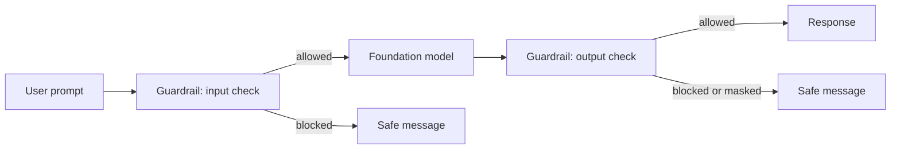

# Day 16 — Responsible AI and Amazon Bedrock Guardrails

- Domain: D4 Guidelines for Responsible AI
- Task statements: 4.1
- Time needed: 2.5 hours (plus 1 hour for Lab 3)
- Hands-on task: Lab 3 (Guardrail test)
- Last verified: 2026-11-24 (against exam guide v1.2)

## 1. Definition

**Responsible AI** means building and using AI that is fair, safe, reliable, transparent and respectful of privacy.

## 2. Why it matters (exam focus)

Task 4.1 asks you to **explain** features of responsible AI, **tools** to support it, legal risks, dataset traits, and how to **monitor** for bias.

## 3. Core dimensions

| Dimension | Meaning |
|---|---|
| Fairness | Similar outcomes for different groups |
| Inclusivity | Works for diverse users |
| Robustness | Stable when inputs change or are noisy |
| Safety | Avoids harmful output |
| Veracity | Truthful and accurate |
| Privacy and security | Protects personal and sensitive data |
| Explainability and transparency | People can understand the system (Day 17) |
| Governance | Clear owners, rules and audits |

## 4. Amazon Bedrock Guardrails

Guardrails are configurable safeguards that check **inputs** and **model outputs**. They work with models on Bedrock, and with other models through the ApplyGuardrail API.

| Safeguard | What it does |
|---|---|
| Content filters | Detect harmful text or images: hate, insults, sexual, violence, misconduct, and prompt attacks (jailbreaks, prompt injection) |
| Denied topics | Block topics you define (for example, investment advice) |
| Word filters | Block specific words or phrases |
| Sensitive information filters | Detect and mask or block PII |
| Contextual grounding checks | Detect answers not grounded in the source or not relevant to the query (hallucination control) |
| Automated Reasoning checks | Check responses against logical rules for accuracy |

## 5. Legal and business risks of GenAI

- Intellectual property claims
- Biased or harmful outputs
- Loss of customer trust
- Risk to end users from wrong answers
- Hallucinations that mislead

## 6. Dataset traits for responsible AI

Diverse, balanced, curated, representative and inclusive. Check data sources and rights.

## 7. Bias and variance

- **High bias** means a too-simple model (underfit). It can miss patterns for some groups.
- **High variance** means a model too tied to its training data (overfit). It can fail on new groups.
- Both can create unfair or unreliable results for subgroups.

## 8. Monitoring bias and truthfulness

- Check label quality.
- Use human audits.
- Compare results across subgroups.
- Track errors and complaints over time.

Services such as SageMaker Clarify help with bias analysis. It is not on the published in-scope list, so know the name only.

## 9. Responsible model selection

Think about the environment (compute and energy use), the sustainability goal and the risk of the task. Pick the smallest model that meets the need.

## 10. DevOps link

Guardrails are like a WAF and input validation for AI. You add them at the edge, and they work for every model behind them.

## 11. Exam traps

- "Block a topic" is **denied topics**. "Mask PII" is **sensitive information filters**.
- "Answer not supported by the source" is **contextual grounding check**.
- Guardrails reduce risk. They do not remove it. Keep human review for high-impact uses.

## 12. Practice questions

1. A bank wants the assistant to refuse any request for personal investment advice. Which Guardrails policy fits?
   - A. Denied topics
   - B. Contextual grounding checks
   - C. Provisioned Throughput
   - D. Batch inference
2. A team wants to detect model answers that are not supported by the source documents. Which Guardrails policy fits?
   - A. Word filters
   - B. Contextual grounding checks
   - C. Content filters for violence
   - D. Sensitive information filters
3. Which TWO can Amazon Bedrock Guardrails do? (Choose TWO.)
   - A. Detect and filter harmful content in prompts and responses
   - B. Mask or block personally identifiable information (PII)
   - C. Train a new foundation model from scratch
   - D. Patch the operating system on EC2
   - E. Replace IAM

## 13. Answer key

> Cover this section until you have answered.

1. **A.** Denied topics block topics you define. B checks grounding. C and D are capacity and processing options.
2. **B.** Contextual grounding checks detect ungrounded or irrelevant answers. A blocks listed words. C filters harmful categories. D handles PII.
3. **A and B.** Guardrails filter harmful content and handle PII. C, D, E are not Guardrails functions.

## Recap

1. Responsible AI: fair, inclusive, robust, safe, truthful, private, transparent, governed.
2. Guardrails check input and output: content filters, denied topics, word filters, PII, grounding, automated reasoning.
3. Monitor bias with subgroup checks and human audits.

## Sources

- Guardrails overview: https://docs.aws.amazon.com/bedrock/latest/userguide/guardrails.html
- Guardrails policies list: https://aws.amazon.com/blogs/machine-learning/tailor-responsible-ai-with-new-safeguard-tiers-in-amazon-bedrock-guardrails/
- Guardrails with non-Bedrock models: https://aws.amazon.com/blogs/aws/guardrails-for-amazon-bedrock-can-now-detect-hallucinations-and-safeguard-apps-built-using-custom-or-third-party-fms/
- Exam guide, domain 4: https://docs.aws.amazon.com/aws-certification/latest/ai-practitioner-01/ai-practitioner-01-domain4.html

Next: Day 17 — transparency and explainability.
