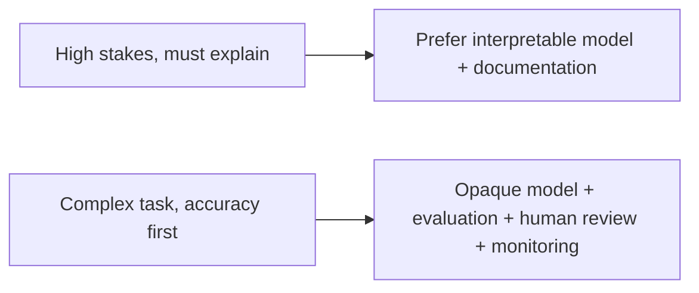

# Day 17 — Transparent and Explainable Models

- Domain: D4 Guidelines for Responsible AI
- Task statements: 4.2
- Time needed: 2 hours
- Hands-on task: read one example SageMaker Model Card and list its sections
- Last verified: 2026-11-24 (against exam guide v1.2)

## 1. Definition

- **Transparency** means people can see how a system is built, trained and used.
- **Explainability** means people can understand why a model gave a result.

## 2. Why it matters (exam focus)

Task 4.2 asks you to **recognize** why these matter, the tools that help, and the trade-offs. Regulated users (banks, health) often need to explain decisions.

## 3. Transparent vs opaque models

| | Interpretable (transparent) model | Opaque ("black box") model |
|---|---|---|
| Examples | Linear regression, decision tree | Deep neural network, large LLM |
| Explain why | Easy | Hard |
| Power on complex data | Often lower | Often higher |
| Use when | You must justify each decision | Accuracy on complex data matters most, with other controls |

Trade-off: more powerful models are often harder to explain. Safety and transparency can pull in different directions, so teams balance them for each use case.

## 4. Tools and documents

| Tool | What it gives you |
|---|---|
| **Amazon SageMaker Model Cards** | A single record of a model: intended use, risk rating (unknown, low, medium or high), training details, evaluation results, notes |
| **Amazon Bedrock Model Evaluations** | Scores to compare models and show quality and safety results |
| Open-source models | You can inspect weights, code and licensing. Check the data and license terms |
| Data and license records | Show where training data came from and what you may do with it |

Model cards help with governance and audits. SageMaker Model Dashboard (not on the in-scope list) shows deployed models and their risk ratings.

## 5. Human-centered design

- Give users ways to **give feedback** and correct errors.
- Keep **humans in the loop** for high-impact decisions.
- Explain to users when they talk to AI, and what its limits are.
- Make decisions and their reasons visible when you can.
- Design for different users and abilities.

## 6. DevOps link

A model card is like a README plus a runbook plus a risk register for a model. Teams read it before they deploy.

## 7. Exam traps

- "Document intended use and risk rating of a model" is **SageMaker Model Cards**.
- A decision tree is easier to explain than a deep neural network.
- Transparency does not mean sharing private training data. It means clear documentation.

## 8. Practice questions

1. A team must record a model's intended use, risk rating and evaluation results in one place for audits. Which service fits?
   - A. Amazon SageMaker Model Cards
   - B. Amazon Polly
   - C. AWS Artifact
   - D. Amazon Lex
2. Which model is generally the easiest to explain to a regulator?
   - A. A decision tree
   - B. A very large deep neural network
   - C. A multimodal LLM
   - D. A diffusion model
3. Which TWO are parts of human-centered design for AI? (Choose TWO.)
   - A. Give users a way to report errors and give feedback
   - B. Keep human review for high-impact decisions
   - C. Hide how decisions are made
   - D. Remove all human oversight
   - E. Never tell users that AI is used

## 9. Answer key

> Cover this section until you have answered.

1. **A.** Model Cards store intended use, risk rating, training and evaluation details. B makes speech. C gives AWS compliance reports. D builds chatbots.
2. **A.** Decision trees are interpretable. B, C, D are large, hard-to-explain models.
3. **A and B.** Feedback and human review are core to human-centered design. C, D, E reduce trust and safety.

## Recap

1. Transparency is about documentation. Explainability is about why a result happened.
2. Simple models explain more easily. Powerful models often explain less.
3. Use Model Cards, evaluations and human oversight.

## Sources

- Exam guide, domain 4: https://docs.aws.amazon.com/aws-certification/latest/ai-practitioner-01/ai-practitioner-01-domain4.html
- SageMaker Model Cards: https://docs.aws.amazon.com/sagemaker/latest/dg/model-cards.html
- Model Dashboard: https://docs.aws.amazon.com/sagemaker/latest/dg/model-dashboard.html
- Interpretable vs opaque model examples are standard (general knowledge).

Next: Day 18 — securing AI systems.
