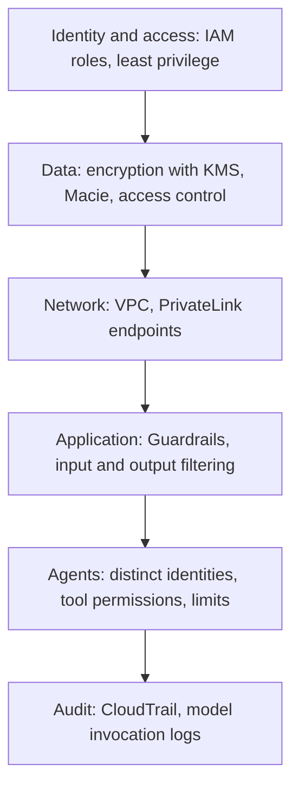

# Day 18 — Securing AI Systems

- Domain: D5 Security, Compliance, and Governance for AI Solutions
- Task statements: 5.1
- Time needed: 2.5 hours
- Hands-on task: optional read-only look at the Bedrock VPC endpoint and model invocation logging settings
- Last verified: 2026-11-24 (against exam guide v1.2)

## 1. Definition

Securing an AI system means protecting the **data**, the **model**, the **application** and the **agents** from misuse, leaks and attacks.

## 2. Why it matters (exam focus)

Task 5.1 asks you to **explain** methods to secure AI. You know most of the base services from AWS work. Today you apply them to AI.

## 3. Shared responsibility

AWS secures the cloud infrastructure and managed service. You secure your data, your access rules, your prompts and your application. How much you own depends on the service (more for SageMaker AI, less for Bedrock). Day 19 shows the Scoping Matrix for this.

## 4. Controls by layer

| Control | Service or feature | Use |
|---|---|---|
| Least privilege | AWS IAM roles and policies | Only needed access to models, data and tools |
| Encryption at rest and in transit | AWS KMS, TLS | Protect training data, prompts, knowledge bases |
| Find sensitive data | Amazon Macie | Discover PII in S3 before training or indexing |
| Private connectivity | AWS PrivateLink (VPC endpoints) | Keep model traffic off the public internet |
| Filter inputs and outputs | Bedrock Guardrails | Block attacks, toxicity, PII |
| Agent identity | Amazon Bedrock AgentCore Identity | Gives agents distinct workload identities. It can federate with OIDC identity providers such as Amazon Cognito or Okta |
| Resource policies | AgentCore resource-based policies | Control who can invoke or manage Runtime, Gateway and Memory |
| Audit trail | AWS CloudTrail, invocation logging | Record who did what |

AgentCore Runtime runs each user session in its own isolated microVM, which prevents cross-session data leaks. The guide also names AgentCore policy features. Read the AgentCore docs for current detail.

## 5. Threats and fixes

| Threat | Fix |
|---|---|
| Prompt injection | Guardrails prompt-attack filter, separate instructions from data, least-privilege tools |
| Data leakage | Redact PII, access control at retrieval time, private networking |
| Toxic or harmful output | Output filters and content moderation |
| Hallucination | **Grounding:** RAG with trusted sources, contextual grounding checks, output validation, confidence scoring |
| Excess agent power | Step limits, human approval, narrow tool permissions |
| Poisoned data | Data validation, lineage, trusted sources |

## 6. Secure data engineering

- Check data quality and integrity.
- Use privacy-protecting methods (redaction, masking).
- Control who can read, write and change data.
- Track **data lineage** (where data came from) and keep a catalog. Use model cards for models.

## 7. DevOps link

This is the same security work you do for services: IAM, encryption, private endpoints, audit logs. Agents add one new idea: treat tool permissions like IAM policies for a non-human user.

## 8. Exam traps

- "Keep traffic to Bedrock off the public internet" is **PrivateLink (VPC interface endpoint)**.
- "Find PII in S3 data" is **Macie**.
- "Who called the API" is **CloudTrail**.
- Raising temperature does not fix hallucination. Grounding does.
- AWS WAF, GuardDuty and Shield are **out of scope** for this exam.

## 9. Practice questions

1. A company wants traffic between its VPC and Amazon Bedrock to stay on the AWS network. Which feature fits?
   - A. AWS PrivateLink (VPC interface endpoint)
   - B. Amazon Polly
   - C. A public NAT gateway only
   - D. Amazon Lex
2. A team must find personally identifiable information in S3 buckets before using the data for training. Which service fits?
   - A. Amazon Macie
   - B. Amazon Transcribe
   - C. Amazon Personalize
   - D. AWS Budgets
3. Which TWO actions help reduce hallucinations by grounding answers? (Choose TWO.)
   - A. Use RAG with trusted source documents
   - B. Use contextual grounding checks
   - C. Set temperature to the maximum
   - D. Disable all logging
   - E. Remove the system prompt

## 10. Answer key

> Cover this section until you have answered.

1. **A.** PrivateLink gives private connectivity to the service. B, D are AI services. C still uses a public path.
2. **A.** Macie discovers sensitive data in S3. B is speech to text. C recommends items. D tracks cost.
3. **A and B.** RAG with trusted sources and grounding checks tie answers to sources. C adds randomness. D, E remove protections.

## Recap

1. Layers: IAM, encryption (KMS), Macie, PrivateLink, Guardrails, agent identity, audit logs.
2. Threats: prompt injection, leakage, toxicity, hallucination, over-powered agents.
3. Ground answers with trusted sources. Log and audit.

## Sources

- Exam guide, domain 5: https://docs.aws.amazon.com/aws-certification/latest/ai-practitioner-01/ai-practitioner-01-domain5.html
- AgentCore Runtime isolation and Identity: https://docs.aws.amazon.com/bedrock-agentcore/latest/devguide/agents-tools-runtime.html and https://aws.amazon.com/blogs/security/securely-exposing-amazon-bedrock-agentcore-runtime/
- AgentCore resource-based policies: https://docs.aws.amazon.com/bedrock-agentcore/latest/devguide/resource-based-policies.html
- Guardrails prompt attacks: https://docs.aws.amazon.com/bedrock/latest/userguide/guardrails-components.html
- Macie, KMS, PrivateLink and CloudTrail roles are standard (general knowledge).

Next: Day 19 — governance and compliance.
