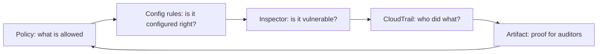

# Day 19 — Governance and Compliance for AI

- Domain: D5 Security, Compliance, and Governance for AI Solutions
- Task statements: 5.2
- Time needed: 2.5 hours
- Hands-on task: optional. Open AWS Artifact and AWS Trusted Advisor in the console (read-only) and note what each shows
- Last verified: 2026-11-24 (against exam guide v1.2)

## 1. Definition

**Governance** is the set of rules, owners and checks that keep AI use safe, legal and aligned with company policy. **Compliance** is proof that you follow those rules and outside regulations.

## 2. Why it matters (exam focus)

Task 5.2 asks you to **recognize** governance and compliance tools, data governance practices, and governance processes. You do not need legal detail. You need to match tools to jobs.

## 3. AWS services for governance (named in the guide)

| Service | Job |
|---|---|
| **AWS Config** | Records resource configuration and checks it against rules |
| **Amazon Inspector** | Scans workloads for vulnerabilities |
| **AWS Artifact** | Gives access to AWS compliance reports and agreements |
| **AWS CloudTrail** | Logs API calls: who did what, when |
| **AWS Trusted Advisor** | Checks your account against best practices |

## 4. Data governance

- **Lifecycle:** collect, store, use, archive, delete
- **Logging:** record access and changes
- **Residency:** keep data in allowed Regions
- **Monitoring:** watch for misuse and drift
- **Retention:** keep data only as long as needed and as the law requires

## 5. Governance process

- Policies for AI use and data use
- Review cadence (regular reviews of models and risks)
- Review strategies (who approves new AI uses)
- Transparency standards (what to disclose to users)
- Team training on responsible AI and security

## 6. Generative AI Security Scoping Matrix

The matrix has **five scopes**. It shows how much you own as you move from using to building.

| Scope | Name | You control |
|---|---|---|
| 1 | Consumer applications | Almost nothing. You use a public AI app |
| 2 | Enterprise applications | Your data use and settings in a vendor AI app |
| 3 | Pre-trained models | Your app, tools and data, using an FM (for example, from Bedrock) |
| 4 | Fine-tuned models | Customization data, plus Scope 3 items |
| 5 | Self-trained models | Everything, from training data to the app |

For Scope 1 and 2, act like a buyer: manage data sharing and read the agreements. For Scope 3 to 5, you also own more of the security design.

There is also an **Agentic AI Security Scoping Matrix** that grades how much autonomy an agent has. It starts at "no agency" (fixed steps) and moves up. More autonomy needs stronger controls.

## 7. Regulations

Expect awareness only: AI rules differ by country and industry. Use AWS Artifact for AWS compliance evidence. Ask your legal and compliance team for the rules that apply to you.

## 8. DevOps link

Config is drift detection. CloudTrail is your audit log. Inspector is your vulnerability scanner. Artifact is your auditor's download page. The new part is writing AI policies and review cycles.

## 9. Exam traps

- "Download AWS compliance reports" is **Artifact**.
- "Record of API activity" is **CloudTrail**.
- "Is this resource configured to the rule" is **Config**.
- "Scan for vulnerabilities" is **Inspector**.
- Scoping matrix **Scope 3** = build on a pre-trained FM. **Scope 5** = train from scratch.

## 10. Practice questions

1. A company's auditor asks for AWS compliance reports such as SOC and ISO. Where does the company get them?
   - A. AWS Artifact
   - B. AWS CloudTrail
   - C. Amazon Polly
   - D. Amazon Lex
2. Which service records who called Amazon Bedrock APIs, and when?
   - A. AWS CloudTrail
   - B. AWS Artifact
   - C. Amazon Textract
   - D. Amazon Transcribe
3. Which TWO statements about the Generative AI Security Scoping Matrix are correct? (Choose TWO.)
   - A. It has five scopes
   - B. Scope 1 covers consumer applications
   - C. It has ten scopes
   - D. Scope 5 means using a public chatbot
   - E. It is only about billing

## 11. Answer key

> Cover this section until you have answered.

1. **A.** Artifact provides compliance reports and agreements. B logs API calls. C, D are AI services.
2. **A.** CloudTrail records API activity. B gives reports. C, D are AI services.
3. **A and B.** The matrix has five scopes, and Scope 1 is consumer apps. C is wrong. D is wrong (Scope 5 is self-trained models). E is wrong.

## Recap

1. Config = configuration rules. Inspector = vulnerabilities. Artifact = compliance reports. CloudTrail = audit log. Trusted Advisor = best-practice checks.
2. Data governance: lifecycle, logging, residency, monitoring, retention.
3. Scoping Matrix has five scopes: consumer, enterprise, pre-trained, fine-tuned, self-trained.

## Sources

- Exam guide, domain 5: https://docs.aws.amazon.com/aws-certification/latest/ai-practitioner-01/ai-practitioner-01-domain5.html
- Scoping Matrix (AWS whitepaper): https://docs.aws.amazon.com/whitepapers/latest/navigating-security-landscape-genai/scoping-generative-ai-use-cases.html
- Scoping Matrix introduction (scope names): https://aws.amazon.com/blogs/security/securing-generative-ai-an-introduction-to-the-generative-ai-security-scoping-matrix/
- Agentic AI Security Scoping Matrix: https://aws.amazon.com/blogs/security/the-agentic-ai-security-scoping-matrix-a-framework-for-securing-autonomous-ai-systems/
- Short service descriptions for Config, Inspector, Artifact, CloudTrail and Trusted Advisor are standard (general knowledge). Scope 2 and Scope 4 wording is summarized. Read the AWS blog for the exact definitions.

Next: Day 20 — review of Domains 4 and 5.
