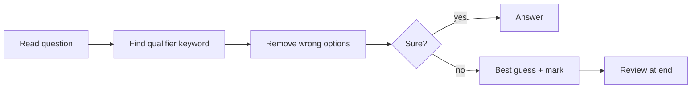

# Exam Day

Each item gets confirmed against official AWS / Pearson VUE pages before use.

## Booking (to confirm)

1. Sign in to AWS Training and Certification.
2. Choose AIF-C01 and Pearson VUE.
3. Pick online proctored or test centre.
4. Request the 30-minute ESL extension before booking, if available.
5. Check ID rules and system test (online only).

## Timing

- About 80 seconds per question (90 min / 65 questions).
- First pass: answer or mark. Do not get stuck.
- Second pass: review marked questions.

## Tactics

- Remove clearly wrong options first.
- Read the qualifier: "MOST cost-effective", "LEAST operational effort", "no ML expertise".
- Managed / serverless option usually wins "least effort" questions.
- No penalty for wrong answers: answer every question.

