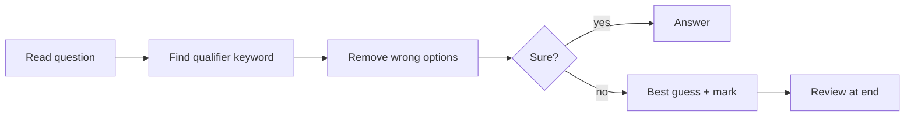

# Exam Day

Last verified: 2026-11-24 against AWS Certification pages (exam overview, "Before testing", "During testing").
Check the pages again before you book. Policies can change.

## Booking

1. Sign in to your AWS Certification account.
2. **Request the ESL +30 minutes accommodation first.** AWS requires accommodations before you schedule the exam.
   Path: Go to your Account → Request Exam Accommodations → Request Accommodation → Accommodation Type: **ESL +30 MINUTES** → Create.
3. Choose AIF-C01 and Pearson VUE.
4. Pick online proctored or test centre.
5. Check ID rules and run the system test (online only) before exam day.
6. Fee: 100 USD. Tax and exchange rate can change the final price. Dates can usually be changed up to 24 hours before the exam (check the current policy when you book).

## Check-in

- Test centre: arrive 15 to 30 minutes early.
- Online: you can launch the exam up to 30 minutes before the start time. Do the system test first. Use a private room.

## Timing

- Without ESL: 90 min / 65 questions = about 83 seconds per question.
- With ESL +30: 120 min / 65 questions = about 110 seconds per question.
- First pass: answer or mark. Do not get stuck.
- Second pass: review marked questions.
- Keep 10 minutes at the end for review.

## Tactics

- Remove clearly wrong options first.
- Read the qualifier: "MOST cost-effective", "LEAST operational effort", "no ML expertise".
- Heuristic (not a rule): a managed or serverless option often wins "least effort" questions.
- For multiple response, count the answers the question asks for.
- No penalty for wrong answers. Unanswered questions count as wrong. Answer every question.
- The exam is scored as a whole. You do not need to pass each domain alone. Still, do not skip a domain.

## Sources

- AWS Certified AI Practitioner exam page: https://aws.amazon.com/certification/certified-ai-practitioner
- Exam guide: https://docs.aws.amazon.com/aws-certification/latest/ai-practitioner-01/ai-practitioner-01.html
- Before testing (accommodations): https://aws.amazon.com/certification/policies/before-testing/
- During testing (check-in, ID): https://aws.amazon.com/certification/policies/during-testing/
