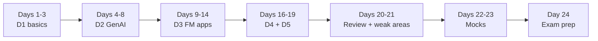

# Study Plan (DRAFT, 24 days)

Last verified: 2026-11-24. Built from the official guide v1.2. See [`exam-guide-map.md`](exam-guide-map.md).

This is a draft. Day 0 finds your real study time `[X]` hours per day and your exam date. Then rescale the plan.
Lesson days follow the exam weights closely: D1 19%, D2 25%, D3 31%, D4 12.5%, D5 12.5% (weights are 20/24/28/14/14).

Rules:
- Each day: topic, time, 1 hands-on task (if any), 5 practice questions (include multiple response), 3-line recap.
- Every 5th day is a review day.
- Last week: 2 timed mock exams (65 questions, 90 minutes) and a full wrong-answer review.
- Request ESL +30 **before** you book the exam (see `../exam-day.md`).

| Day | Domain | Task | Topic | Lab |
|---|---|---|---|---|
| 0 | – | – | Check live exam guide, 5 diagnostic questions, set `[X]`, `[Y]`, date | – |
| 1 | D1 | 1.1 | Basic AI terms, learning types, data types, inference types, agentic AI intro | – |
| 2 | D1 | 1.2 | Use cases, when NOT to use AI, regression/classification/clustering, managed AI services | Lab 5 |
| 3 | D1 | 1.3 | ML lifecycle, FM sources, MLOps, metrics | Lab 4 |
| 4 | D2 | 2.1 | Tokens, embeddings, chunking, transformers, FM lifecycle, token pricing, context engineering | – |
| 5 | Review | D1 | Review D1 + 5 mixed questions | – |
| 6 | D2 | 2.1 | Agentic AI: multi-agent patterns, MCP, memory, tool use, orchestration | – |
| 7 | D2 | 2.2 | GenAI strengths and limits, model selection factors, business metrics | – |
| 8 | D2 | 2.3 | Bedrock, SageMaker AI, JumpStart, Nova, Quick, Kiro, Strands, AgentCore, cost tradeoffs | Lab 1 |
| 9 | D3 | 3.1 | FM selection, inference parameters, prompt caching | – |
| 10 | Review | D2 | Review D2 + 5 mixed questions | – |
| 11 | D3 | 3.1 | RAG, Knowledge Bases, vector stores, customization cost, agents in business | Lab 2 |
| 12 | D3 | 3.2 | Prompt engineering, risks, Prompt Management | – |
| 13 | D3 | 3.3 | Pre-training, fine-tuning, distillation, data preparation, RLHF | – |
| 14 | D3 | 3.4 | Evaluation: ROUGE, BLEU, BERTScore, LLM-as-judge, Model Evaluation, RAG/agent evaluation | – |
| 15 | Review | D3 | Review D3 + 5 mixed questions | – |
| 16 | D4 | 4.1 | Responsible AI, Guardrails, bias/variance, legal risks | Lab 3 |
| 17 | D4 | 4.2 | Transparency, explainability, Model Cards, human-centered design | – |
| 18 | D5 | 5.1 | Secure AI: IAM, encryption, Macie, PrivateLink, AgentCore Identity/Policy, prompt injection, grounding | – |
| 19 | D5 | 5.2 | Governance: Config, Inspector, Artifact, CloudTrail, Trusted Advisor, Scoping Matrix, data governance | – |
| 20 | Review | D4+D5 | Review D4 + D5, finish service picker | – |
| 21 | All | – | Re-teach weak areas from the scoreboard | – |
| 22 | Mock | – | Mock exam 1 (timed) + wrong-answer review | – |
| 23 | Mock | – | Mock exam 2 (timed) + wrong-answer review | – |
| 24 | All | – | Light review, cheat sheets, exam-day checklist | – |

