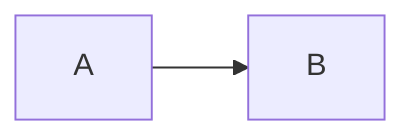

# Day NN — <Topic>

- Domain: Dx
- Task statements: x.y (use the numbers from `plan/exam-guide-map.md`)
- Time needed: <hours>
- Hands-on task: <one small task, or "none">
- Last verified: <YYYY-MM-DD> (against exam guide v<version>)

> Write in ASD-STE100 simplified English. Short sentences. One idea each. Active voice.
> Stay inside the exam guide. Mark extra content as "Beyond the guide".

## 1. Definition

## 2. Why it matters (exam focus)

Which task statement tests this? What does the exam ask you to do: define, identify, describe, compare, select?

## 3. Diagram

## 4. Real example (DevOps / cloud)

## 5. Comparison table

| Option | Use when | Do not use when |
|---|---|---|

## 6. Pick this when / not this when

## 7. Exam traps and keywords

## 8. Practice questions

Write 2 multiple choice and 1 multiple response. Say how many answers to pick.

1. …
2. …
3. … (Choose TWO.)

## 9. Answer key

> Cover this section until you have answered. For every question, give the reason each wrong option is wrong.

1.
2.
3.

## Recap

1.
2.
3.

## Sources

- <title> — <URL> — <date read>

Next:
