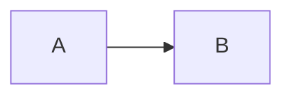

# Day NN — <Topic>

- Domain: Dx
- Time needed: <hours>
- Hands-on task: <one small task>

## 1. Definition

## 2. Why it matters (exam focus)

## 3. Diagram

## 4. Real example (DevOps / cloud)

## 5. Comparison table

| Option | Use when | Do not use when |
|---|---|---|

## 6. Pick this when / not this when

## 7. Exam traps and keywords

## 8. Practice questions

1. …
2. …
3. …

Answers and explanations

## Recap

1.
2.
3.

Next:
